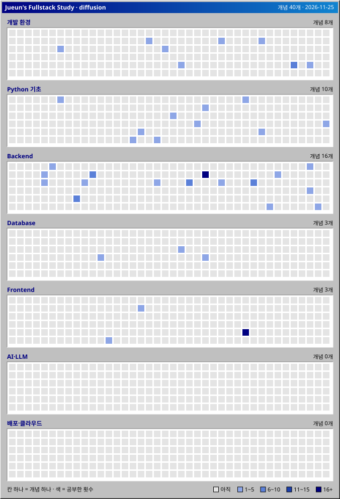

# Jueun's Fullstack Study · diffusion

> 간호사 출신 비개발자가 5개월 풀스택 과정을 **확산 모델(diffusion model)처럼** 배우는 공부 기록이에요.
> 처음엔 전부 노이즈였던 지식 지도가, 문제를 하나씩 풀 때마다 조금씩 선명해지는 과정을 매일 남겨요.

- 기간: 2026년 11월 ~ 2027년 3월 (풀스택 개발 과정: Python, FastAPI, DB, React, AI, 배포)
- 사이트: `index.html` 하나 (GitHub Pages에서 바로 볼 수 있어요)
- 기록: `knowledge-state.json`, `notes/날짜.md`


<!-- GRASS:START -->


- 노이즈가 걷힌 칸: **40 / 1,920** (2.1%)
- 공부한 날: **2일** · 마지막 업데이트: 2026-11-24
- 가장 많이 공부한 개념: JWT 및 쿠키 인증 10회, React 상태 관리 9회, OAuth 2.0 소셜 로그인 8회, uv run 6회, 라우트(엔드포인트) 6회
<!-- GRASS:END -->

---

## 왜 이렇게 공부하나요

저는 간호사로 일했고, 의료 데이터와 서비스 기획 일을 하다가 개발을 배우기 시작했어요.
수업은 기초 문법부터 순서대로 아주 빠르게 나가는데, 순서대로 듣기만 해서는 머리에 남지 않았어요.
강사님 코드를 받아 치는 것과 그 코드를 이해하는 것은 전혀 다른 일이었어요.

그래서 방향을 뒤집었어요.

- **기초부터 위로(bottom-up)가 아니라, 만들고 싶은 것에서 아래로(top-down).**
  먼저 실제로 돌아가는 것을 만들고, 그 코드 한 줄을 이해하는 데 필요한 기초 개념만큼 거꾸로 파고들어요.
- **AI를 정답 자판기가 아니라 과외 선생님으로.**
  매번 "기초부터, 10~12살에게 설명하듯, 내가 이해했다고 가정하지 말고" 설명해 달라고 해요.
- **남긴 만큼 남는다.**
  하루가 끝나면 오늘 친 코드의 순서, 파고든 개념, 내가 한 질문을 파일로 남기고 지도에 칠해요.

이 방식은 BZCF 채널에서 본 Gabriel Petersson의 이야기에서 출발했어요.
고등학교를 그만두고 OpenAI 연구자가 되기까지, AI와 함께 위에서 아래로 파고드는 방식으로 공부했다는 인터뷰였어요.
([원본 인터뷰](https://www.youtube.com/watch?v=vq5WhoPCWQ8))

## 왜 "diffusion"인가요

이미지 생성 AI에 쓰이는 확산 모델은 **완전한 노이즈에서 시작해 노이즈를 조금씩 걷어내며** 선명한 그림을 만들어요
(Ho, Jain & Abbeel, 2020, *Denoising Diffusion Probabilistic Models*).

제 공부도 같은 모양이에요.

| 확산 모델 | 이 공부 기록 |
|---|---|
| 처음엔 전부 노이즈 | 처음엔 1,920칸이 전부 회색 (아직 모르는 개념) |
| 한 단계씩 노이즈를 걷어냄 | 문제 하나를 풀 때마다 필요한 개념 칸이 칠해짐 |
| 반복할수록 그림이 선명해짐 | 같은 개념을 다시 공부할수록 칸이 짙어짐 |
| 전체 윤곽이 먼저, 디테일은 나중에 | 서비스 전체 흐름이 먼저, 기초 문법은 필요할 때 |

사이트 위쪽의 `denoising 25 / 1,920` 숫자가 지금까지 노이즈가 걷힌 칸의 수예요.

## 근거로 삼은 학습 원리

이 공부법 자체의 효과를 실험으로 검증한 것은 아니에요.
대신 학습 연구에서 효과가 반복해서 확인된 원리들을 매일의 루틴에 넣었어요.

| 원리 | 이 기록에서 어떻게 쓰나 | 참고 |
|---|---|---|
| **문제부터 부딪히기** (생산적 실패) | 설명을 먼저 듣지 않고, 만들고 싶은 기능부터 시도한 뒤 막힌 곳을 파고들어요 | Kapur (2008), *Productive failure*, Cognition and Instruction |
| **스스로 설명하기** | 개념 설명을 내 말로 고쳐 쓰면 공부 1회로 세요 | Chi et al. (1989), *Self-explanations*, Cognitive Science |
| **떠올려 보기** (인출 연습) | 복습 때 설명을 다시 읽지 않고, 내가 먼저 설명해 보고 피드백을 받아요 *(준비 중)* | Roediger & Karpicke (2006), *Test-enhanced learning*, Psychological Science |
| **간격 두고 반복하기** | 1일, 3일, 7일, 14일, 30일 뒤에 다시 복습해요 *(준비 중)* | Cepeda et al. (2006), *Distributed practice in verbal recall tasks*, Psychological Bulletin |
| 위 원리들의 종합 평가 | 떠올려 보기와 간격 반복이 가장 효과가 큰 공부법으로 평가됐어요 | Dunlosky et al. (2013), *Improving students' learning with effective learning techniques*, Psychological Science in the Public Interest |

## 하루 루틴

```
⓪ 공부 시작 프롬프트   새 AI 대화 맨 처음에 붙여넣기 (설명 방식 고정)
      ↓
   수업 · 질문          GPT, Gemini, Claude 어느 AI든
      ↓
① 공부 끝 프롬프트     대화 맨 끝에 붙여넣기 → notes/날짜.md
      ↓
② 공부 기록 넣기       notes의 .md를 사이트에 합치기
      ↓
③ 백업 저장            knowledge-state.json 덮어쓰기
      ↓
   GitHub에 올리기      사이트의 공부 달력에서 버튼 한 번
```

## 사이트에서 볼 수 있는 것

- **지식 잔디**: 분야별(개발 환경, Python 기초, Backend, Database, Frontend, AI·LLM, 배포) 한 칸이 개념 하나예요.
  색이 짙을수록 많이 공부한 개념이에요. (1~5회, 6~10회, 11~15회, 16회 이상)
- **개념 설명**: 칸을 누르면 그 개념의 설명이 날짜별로 쌓여 있고, 그 개념이 나온 코드 줄이 함께 보여요.
- **공부 달력**: 날짜를 누르면 그날 푼 문제의 **풀이 순서**(터미널 명령, 코드, 브라우저 확인)가 번호대로 나와요.
  나중에 이 순서대로 다시 따라 치며 복습해요.
- **내가 한 질문**: 그날 AI에게 던진 질문 목록이에요.

## 폴더 구조

```
index.html               사이트 (HTML·CSS·JavaScript 파일 하나)
knowledge-state.json     전체 기록 (문제, 코드 한 줄, 개념, 설명, 질문)
notes/YYYY-MM-DD.md      하루 공부 정리 (AI가 정해진 모양으로 만들어 줌)
study-start-prompt.txt   공부 시작 프롬프트
study-end-prompt.txt     공부 끝 프롬프트
```

## 하루 기록 형식 (notes/날짜.md)

```text
# 2026-11-24 공부 기록
- 날짜: 2026-11-24
- AI: GPT

## 문제: 미니 인스타 백엔드: /posts로 게시물 목록 보내기
- id: mini-insta-posts
- 완료 기준: /posts/1 에서 게시물 하나가 JSON으로 보인다

### 15. 게시물 하나 조회 라우트 추가 `code: backend/main.py`
(코드 블록)
- 개념: 경로 매개변수, 라우트(엔드포인트)
- 메모: {post_id} 자리에 들어온 값이 함수 인자로 들어온다.

## 개념 설명
### 경로 매개변수 `Backend`
(설명)

## 내가 한 질문
1. {post_id}는 왜 중괄호야?
```
